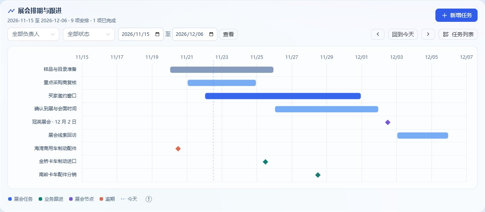
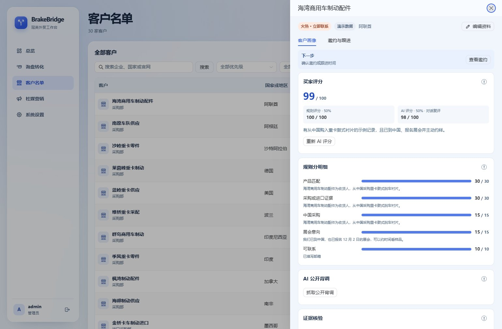
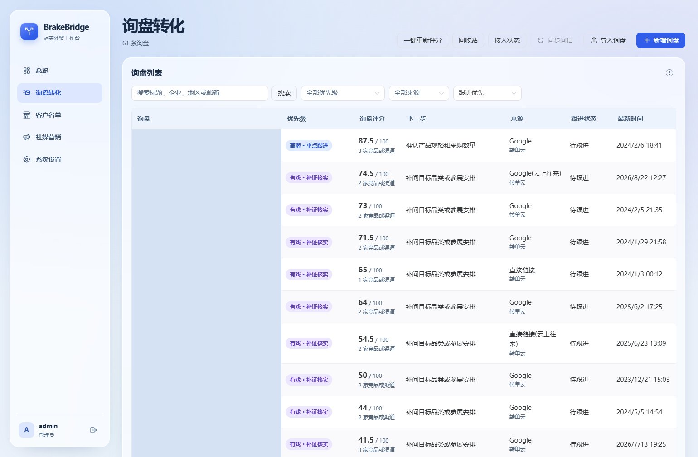
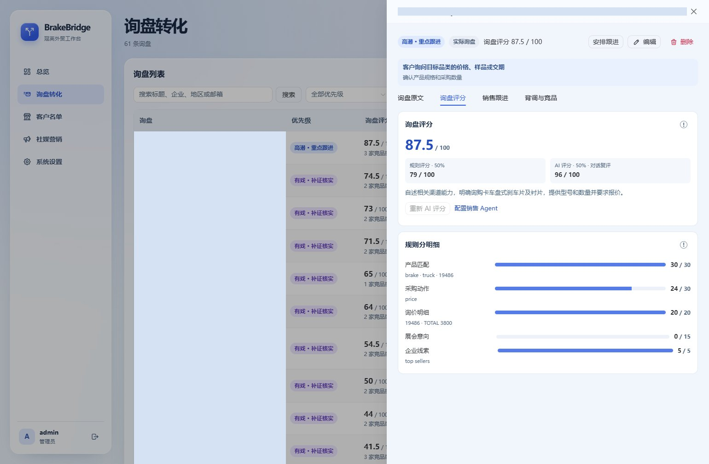
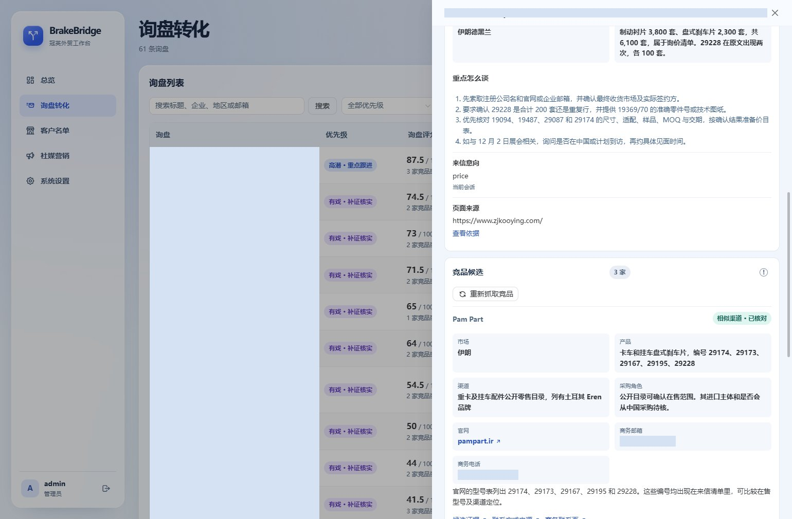
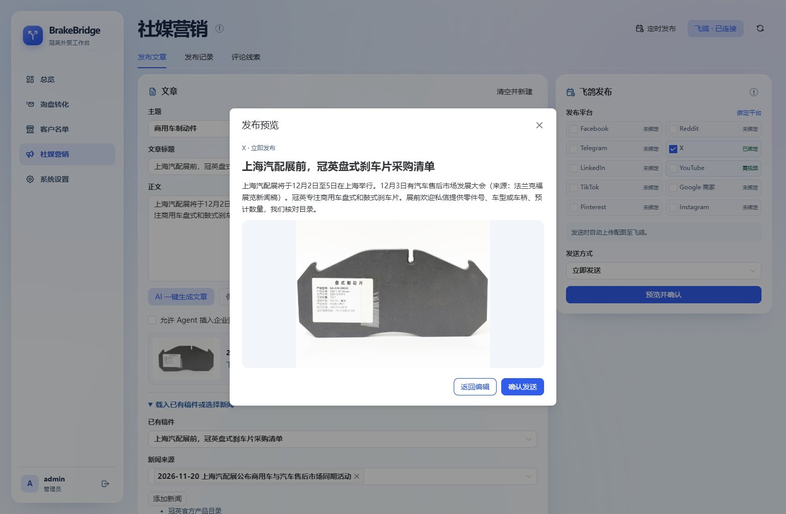
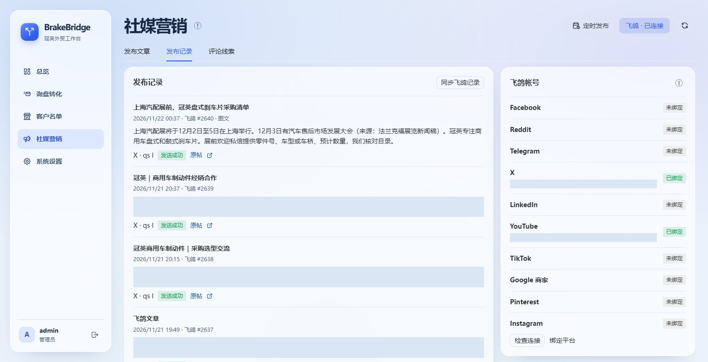
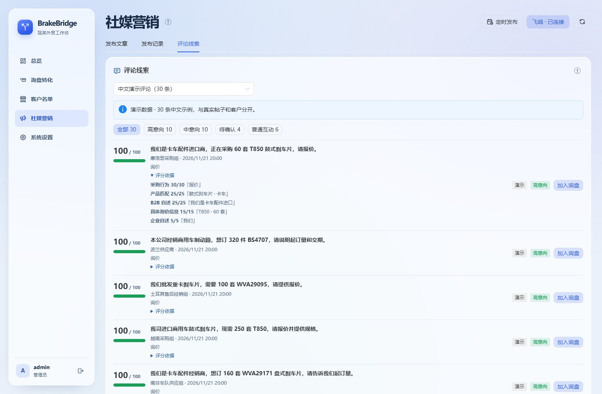
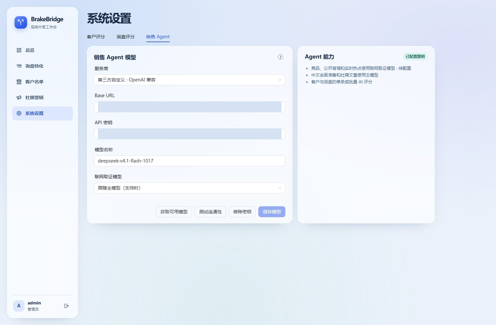

<h1 align="center">BrakeBridge · 冠英外贸工作台</h1>
<p align="center">展会获客、客户跟进、询盘转化和飞鸽图文发布</p>
<p align="center"><a href="#从哪里开始">开始体验</a> · <a href="#社媒营销">图文发布</a> · <a href="#系统设置">配置模型</a> · <a href="#部署与维护">部署与维护</a></p>


BrakeBridge 面向商用车制动件外贸团队。展会出发前可以整理重点买家、准备邀约和社媒内容。收到询盘后，可以从原文确认采购信号，补充企业背景和竞品渠道，再把具体行动记到跟进计划里。

下面的截图均来自实际工作台。配置值、客户识别字段和其他与示例无关的内容已按需遮挡。

| 要做的事 | 从哪里打开 | 能拿到什么 |
| --- | --- | --- |
| 看本周要联系谁、有哪些展会任务 | **总览** | 展会甘特图、到期和逾期待办、重点客户 |
| 从一批客户中选出优先邀约的人 | **客户名单** | 产品匹配、采购证据、优先级和邀约草稿 |
| 看懂转单云询盘和新回信 | **询盘转化** | 中文译文、原文、评分依据和销售跟进 |
| 准备和客户见面、核对同市场的供应渠道 | **询盘转化 → 背调与竞品** | 公开来源、候选企业、中文会面准备卡 |
| 发一条带产品图的展前采购内容 | **社媒营销 → 发布文章** | 中文或英文草稿、可选配图、平台发布回执 |
| 改评分权重，或者接自己的模型 | **系统设置** | 两套可调评分、销售 Agent 和联网取证模型 |

## 从哪里开始

第一次体验，按这一顺序就能看到完整业务链路。界面中的小感叹号可以悬停或用键盘聚焦查看说明。

1. 打开 **总览**，先看待处理数字，再点图表查对应询盘或客户。进入 **展会排期** 可以看任务和会面时间。
2. 打开 **客户名单**，选一条演示客户，查看 **客户画像** 和 **邀约与跟进**。
3. 打开 **询盘转化**，切到按评分排序。打开一条留言，先看 **询盘原文**，再看 **询盘评分** 和 **背调与竞品**。
4. 打开 **社媒营销**，生成或填写一段展前内容，给它选一张企业产品图，进入 **预览并确认**。
5. 连上有权限的飞鸽账号后，可选 **立即发送** 或 **定时发送**。去 **发布记录** 核对平台状态，再打开原帖。

新库带有 **61 条转单云询盘、61 份可匹配的 AI 评分、40 张冠英产品图、30 家演示客户** 和中文演示评论。真实询盘用于获授权的团队环境。演示客户和演示评论带有对应标识。

## 总览

打开 **总览**，用右上角的资料范围切换实际、演示或公开资料。重点买家是「火热」与「高潜」两档的合计。指标卡会打开对应业务页，或跳到本页待办。

| 图表 | 看什么 | 怎么进入明细 |
| --- | --- | --- |
| **新增询盘** | 近 7、14 或 30 天首次提交的询盘数，及上一个同等长度周期的比较 | 点柱形或展开有新增的日期，打开当天的询盘列表 |
| **业务分布** | 客户优先级或询盘跟进进度，包括数量和比例 | 切换维度，点环形扇区或图例看对应名单 |
| **询盘来源** | 转单云、客户回信、人工录入和社媒评论各带来多少询盘 | 点横条按来源查看 |
| **展会重点名单** | 已约见、待确认到展和需优先跟进的线索 | 点客户名称打开询盘详情 |

### 展会排期



横条表示跨日任务，菱形表示单日里程碑或跟进，蓝色虚线标记今天。客户跟进、询盘会面和展会任务按日期放在同一视图里。

- 按负责人、状态和日期筛选，或用上一段、下一段与 **回到今天** 快速移动。
- 点击图上的任务，打开对应的跟进记录或编辑展会任务。切换到 **任务列表** 后也可用键盘逐条查看。
- 通过 **新增任务** 填日期、负责人和状态。在页面底部的 **今日及逾期待办** 检查到期而尚未完成的安排。

## 客户名单


### 导入、识别和补证

1. 点击 **导入**，从导入窗口下载表头模板。可以导入转单云客户管理格式，也可以带上贸易记录或官网证据。
2. 填写客户名称、联系人、来源、重要程度、区域、地址、邮箱及电话。官网、客户描述、社媒账号和标签可按文件中实际有的字段补充。
3. 在名单中按企业、地区或官网搜索，也可以先看 **重点跟进 · 前两档**。
4. 点击客户打开 **客户画像**。看产品匹配、采购身份、中国采购及展会信号，再决定下一步问什么。

重复导入时，系统识别已有客户和重复证据。请在对应客户的详情里修改现有跟进字段，保留负责人和邀请函的业务记录。

### 评分和跟进

| 标记 | 怎么使用 |
| --- | --- |
| 火热 | 优先确认直接联系、会面或展会行程 |
| 高潜 | 核对产品和采购依据，尽快安排跟进 |
| 有戏 | 先补目标型号、采购能力或企业证据 |
| 慢热 | 等待新询盘、回信或明确采购信号 |
| 冷却 | 暂缓跟进，把时间放到更匹配的买家 |

打开 **邀约与跟进**，认领负责人、填写跟进日期和状态，查看或修改英文展会邀约。演示数据用来走流程，发给真实联系人前要确认地址和具体安排。



## 询盘转化



### 把原始询盘放进工作台

| 手上的材料 | 操作 |
| --- | --- |
| 转单云询盘导出 | 点 **导入询盘**，选择 XLSX 的第一张表，或同表头 CSV |
| 一封客户回信 | 选 EML 文件导入，或在配置了 IMAP 后点击 **同步回信** |
| 现场收到的线索 | 点 **新增询盘**，填来源、正文和可用的联系方式 |
| 已接入的评论 | 在 **社媒营销 → 评论线索** 中按意向筛选并转询盘 |

转单云表头为姓名、内容、手机、邮箱、标题、IP、地区、添加时间、来源页面、页面地址、首次访问、分配员工和设备。新增和编辑沿用相同字段。删除进入回收站，可从回收站恢复。导入时按来源指纹去重，保留已有的人工编辑和回收站状态。

### 从一封询盘到一条行动

1. **询盘原文**。看对方原话和来源。外语来信可点翻译查看中文，再回对照原文中的型号、数量和要求。可用翻译方式随本机语言模型或配置而变化。
2. **询盘评分**。查看规则分、AI 分及合成总分。按 **跟进优先** 时，「有戏」同档里已找到候选企业的询盘靠前。同样可以切换到只按评分升降序。
3. **销售跟进**。记录负责人、状态、会面时间和下一步。先确定对方在询什么，再判断要不要备样或邀约。
4. **背调与竞品**。对照公开网站核实企业主体、主要市场和制动件品类。查看现有候选企业，也可触发抓取。公开联系方式只有在能够核对来源时才显示。
5. **会面准备**。用中文查看目标与问题清单。适合带上零件号、车型或车桥、预计数量和需要确认的样品规格去沟通。





### 回信接入与提醒

在 **接入状态** 可以查看 IMAP、翻译和企业微信的配置状态。手动导入仍适用于团队还没有邮箱授权的情况。完成授权后，可以点 **同步回信** 主动检查收件箱。需要定时同步和提醒时，可启用询盘工作进程，部署命令在文末。

## 社媒营销


### 生成文章

在 **发布文章** 中选主题和语言。可以直接填要点，例如「上海汽配展前，为采购商整理盘式刹车片询价需要的资料」。点击 **AI 一键生成文章** 后，标题和正文都能继续编辑。

文章默认采用正式商务语气，核实过的展会动态自然融入正文。来源链接和要点保存在草稿的新闻资料区，方便发布前复核。例如：

> 上海汽配展将于12月2日至5日举行。计划采购商用车制动件的经销商，可在展前提供零件号、车型或车桥及预计数量。冠英将据此协助核对产品目录和样品需求。

| 入口 | 什么时候用 |
| --- | --- |
| **载入已有稿件或选择新闻** | 复用草稿，或者定向选入已核实的来源 |
| **添加新闻** | 手动录入主办方公告标题、链接、发布日期和要点 |
| **生成时联网查新热点** | 配置联网取证模型后，可让 Agent 查找近期有出处的动态 |
| **允许 Agent 插入企业图** | 让 Agent 从现有企业素材中挑一张与文案相符的图 |
| **企业素材库** | 按盘式或鼓式挑图，检查型号，下载或移除当前配图 |
| **保存草稿** | 先留给同事查看，晚些时候再从稿件列表继续 |

产品图片展示目录中的实际产品。展会主办方已公布的开幕日期与活动可以作为文章背景。涉及冠英的展位、出席、产品适配、价格或交期时，先核对企业确认的信息。

### 预览后发布



1. 在右上角 **飞鸽连接** 连接自己的飞鸽账号，并通过 **绑定平台** 确认目标渠道。
2. 在发布面板勾选要发布的平台。X 等支持图片的渠道可直接用当前配图。YouTube 和 TikTok 的入口需要视频。中文短帖发到 X 时，建议在生成前注明渠道和正文长度。
3. 点击 **预览并确认**，检查最终正文、实际图片、渠道和发布时间。
4. 选 **立即发送** 时确认发送。选 **定时发送** 时填北京时间，再确认定时发布。
5. 发布工作进程在提交时自动把产品图上传到飞鸽，再把图与正文一起提交。定时任务到点才上传图片。

**定时发布** 单独显示待发稿件，可预览或取消。**发布记录** 统一展示飞鸽回执和仍在处理的任务，同一篇稿件收到回执后只显示一条。已经同步的正文、平台状态和原帖链接保存在工作台数据库，飞鸽未连接时也能打开工作台查看。飞鸽连通时可点 **同步飞鸽记录** 获取新的回执。



### 实际发文案例

《上海汽配展前，冠英盘式刹车片采购清单》由工作台配置的 B1X 模型生成。文章用主办方公布的展会和汽车售后市场发展大会作为背景，引导采购方在展前提供零件号、车型或车桥和预计数量。Agent 从 40 张素材中选用了 **29030 盘式刹车片**。飞鸽回执 **#2640** 显示 X 发送成功。[主办方公告](https://automechanika-shanghai.hk.messefrankfurt.com/shanghai/zh-cn/press/press-releases/2026/AMS26_PR4.html) · [X 原帖](https://x.com/qsl8880/status/2124180330336661847)

### 看懂发布状态

| 看到的状态 | 可以怎么处理 |
| --- | --- |
| 待发布 | 等到设置的时间，或确认发布工作进程在运行 |
| 等待平台回执 | 点击 **同步飞鸽记录**，等目的平台反馈 |
| 发送成功 | 打开回执里的 **原帖**，核对文章和图片 |
| 部分发送成功或发送失败 | 分别查看各平台状态和提示，再决定是否重新安排 |
| 待核对 | 先在飞鸽和原平台检查是否已经产生帖子，再处理原批次 |

### 从评论找到询盘

打开 **评论线索**，可试用中文演示评论，或者选择已经同步的 Facebook 历史评论、具备评论接口的飞鸽帖子。先按意向筛选，再展开评分依据。对明确询价或表示采购的人可转入 **询盘转化**。同一条评论重复操作会识别原询盘。



## 系统设置

### 客户和询盘分别调权

| 设置 | 默认行为 | 修改后 |
| --- | --- | --- |
| 客户评分 | 按产品、采购、展会和联系方式等规则维度分析 | 保存后重新按当前权重合成分数 |
| 询盘评分 | 按单条询盘信号及对应规则维度分析 | 列表按选定排序方式更新 |
| 规则分与 AI 分 | 两个模块分别默认为各占 50% | 可以拖动百分比，任一方允许为 0% |

例如规则分为 50、AI 分为 70，两者各占一半时，总分为 **60**。使用原有 AI 分重算时，可直接点 **一键重新评分**。需要重新生成当前筛选范围的 AI 分时，从同一入口选择调用销售 Agent。每条详情可区分分数、计算比例和评分理由。


### 配置销售 Agent



1. 打开 **系统设置 → 销售 Agent**，选 DeepSeek、OpenAI、Claude、Gemini、千问、Kimi、智谱、豆包等预设。使用第三方网关时，选 **第三方自定义 · OpenAI 兼容**。
2. 自定义模式填服务商提供的公网 HTTPS Base URL，例如 `https://gateway.example/v1`，以及自己的 API 密钥。
3. 点 **获取可用模型** 后选一个模型，或在 **模型名称** 手填服务商提供的 ID。
4. 点 **测试连通性** 发一条短测试消息。通过后点 **保存模型**。
5. 主模型负责客户评分、会面准备、文案和选图。需要搜索公开来源的竞品、背调和新热点时，可单独配置 **联网取证模型**。

模型连通性测试和实际文章编辑解决的是两个问题。前者检查能否调用模型，后者要求返回完整正文和结构化字段。若界面提示模型没有返回正文或生成结果达到长度上限，检查模型类型及网络，或者缩短原稿后重试。工作台会保留已保存的文章，可继续编辑。

## 常见问题

| 问题 | 处理方法 |
| --- | --- |
| 第一次启动看不到 61 条询盘或素材图 | 查看 Web 和初始化使用的 `BRAKEBRIDGE_DB` 是否相同，必要时用该库运行 `seed company` |
| 已配置模型，生成时却没有联网开关 | 查看 **联网取证模型** 的状态，或选用已经录入的新闻来源生成 |
| 生成了文字却没有图片 | 勾选 **允许 Agent 插入企业图** 再生成，也可以打开素材库手选 |
| 飞鸽显示已保存账号，还是要求验证码 | 从 **飞鸽连接** 打开当前验证码，完成一次授权会话；通过后可以按需开启保活 |
| 定时任务一直显示待发布 | 确认北京时间和工作进程使用的数据库，检查飞鸽账号授权 |
| 图片稿无法勾选 YouTube | 当前稿件是图文时选支持图片的渠道。YouTube 的入口使用视频链接 |
| 回执待核对，还能不能直接再发 | 先看平台原帖和飞鸽记录。有原帖时应对应原批次；确认失败后才重新安排 |

技术栈为 Vue 3、TypeScript、Naive UI、ECharts、Flask 和 SQLite。业务页面、接口与后台任务都使用同一个部署数据库。[团队分工与 PRD](docs/prd/)

## 部署与维护

以下以 Windows PowerShell 为例。准备 Python 3.12、Node.js 24 和 Git，需要验证转单云验证码的环境请安装 Chrome。请使用有权限的 Gitee 账户从仓库克隆。

### 1. 安装并构建

```powershell
git clone https://gitee.com/liuxiansen52/gtm.git
cd gtm
py -3.12 -m venv .venv
.\.venv\Scripts\python.exe -m pip install -r requirements.txt
npm --prefix frontend ci
npm --prefix frontend run build
```

### 2. 初始化并打开工作台

```powershell
$env:BRAKEBRIDGE_DB = Join-Path $env:LOCALAPPDATA 'BrakeBridge\workbench-demo.sqlite3'
.\.venv\Scripts\python.exe -m flask --app app seed demo
.\.venv\Scripts\waitress-serve.exe --host=127.0.0.1 --port=8080 app:app
```

浏览器打开 [http://127.0.0.1:8080](http://127.0.0.1:8080)。本机演示初始账号为 `admin`，默认密码 `123456`。团队部署可在第一次执行初始化前通过本机环境设置 `BRAKEBRIDGE_ADMIN_PASSWORD`。

`seed demo` 会将 `data/company-seed.sqlite3` 的询盘、产品图和可匹配评分导入运行库，并初始化演示客户、任务和评论。种子库用于录入，实际运行用 `BRAKEBRIDGE_DB` 指向的独立 SQLite。已有工作台可以在指向原库后单独运行：

```powershell
.\.venv\Scripts\python.exe -m flask --app app seed company
```

重复运行会识别已导入的询盘和图片，保留原有编辑、跟进及回收站状态。

### 3. 启动发布工作进程

保留 Web 服务窗口，另开 PowerShell，进入相同仓库并指向同一个数据库：

```powershell
$env:BRAKEBRIDGE_DB = Join-Path $env:LOCALAPPDATA 'BrakeBridge\workbench-demo.sqlite3'
.\.venv\Scripts\python.exe -m flask --app app social-worker
```

在页面中连接自己的飞鸽账号，按需配置 Agent。工作进程消费立即与定时发布队列并更新回执。需要执行一轮处理时可以加 `--once`。

### 4. 配置可选接入

| 能力 | 配置位置 |
| --- | --- |
| 展会名称、日期、会场、展位 | 环境变量 `EVENT_NAME`、`EVENT_DATE`、`EVENT_VENUE`、`EVENT_BOOTH` |
| 销售模型或第三方网关 | 系统设置中的 **销售 Agent**，由部署环境保存自己的密钥 |
| 行业 RSS / Atom | `SOCIAL_NEWS_FEEDS` 填逗号分隔的 HTTPS 来源 |
| 邮箱回信 | `LEADS_IMAP_HOST`、`LEADS_IMAP_USER`、`LEADS_IMAP_PASSWORD`，按需 `LEADS_IMAP_FOLDER` |
| 企业微信提醒 | 在运行环境配置 `LEADS_WECOM_WEBHOOK`、`LEADS_PUBLIC_URL` |
| 飞鸽登录使用的 Chrome | 按需通过 `SOCIAL_FIGEON_CHROME` 指定可执行文件路径 |
| 业务运行库与会话 | `BRAKEBRIDGE_DB` 指定 SQLite 文件，团队部署可配置 `BRAKEBRIDGE_SECRET` |

已配置邮箱和提醒渠道，需要后台同步或推送时，在指向相同数据库的终端运行：

```powershell
.\.venv\Scripts\python.exe -m flask --app app inquiry-worker
```

仓库提供获授权团队使用的企业初始数据。运行库、飞鸽会话和模型密钥由各部署环境保存。备份真实跟进记录时备份运行库即可。

```powershell
.\.venv\Scripts\python.exe -m unittest discover -s tests -q
```
