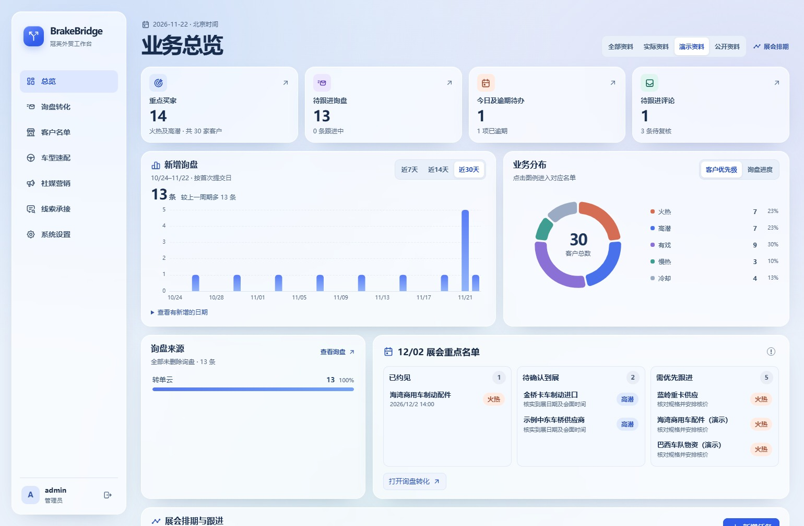
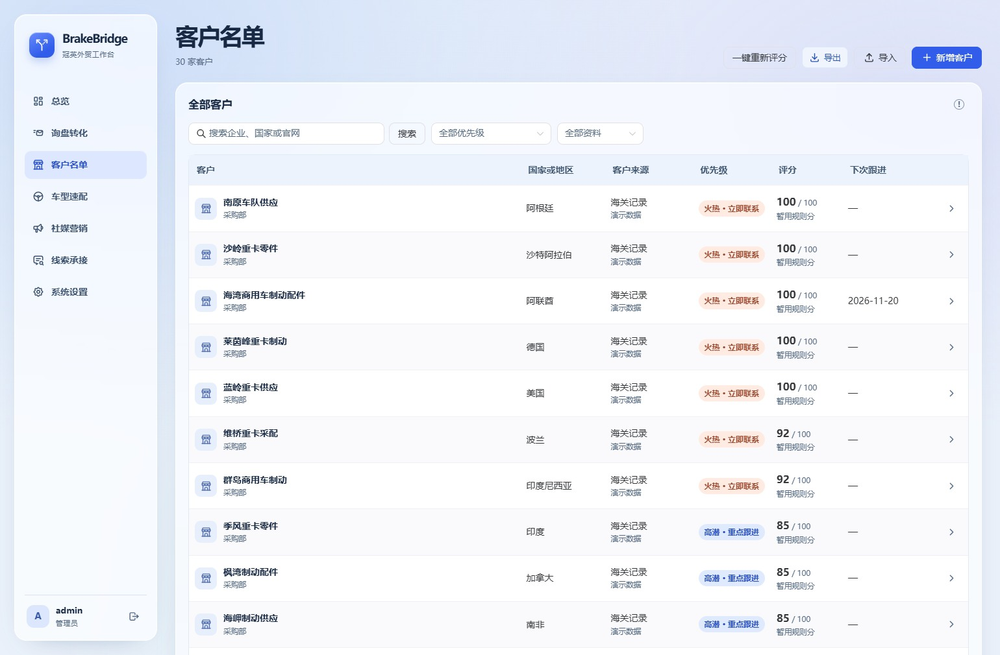
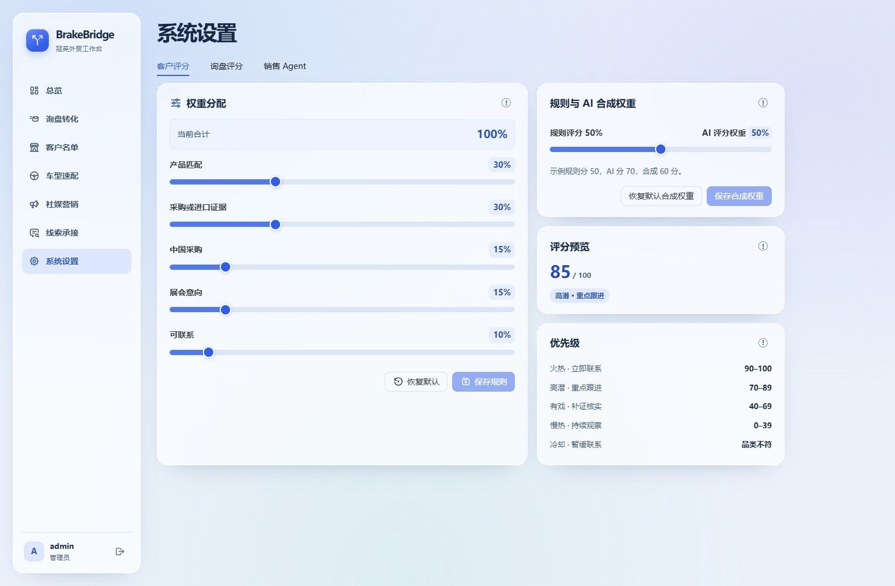
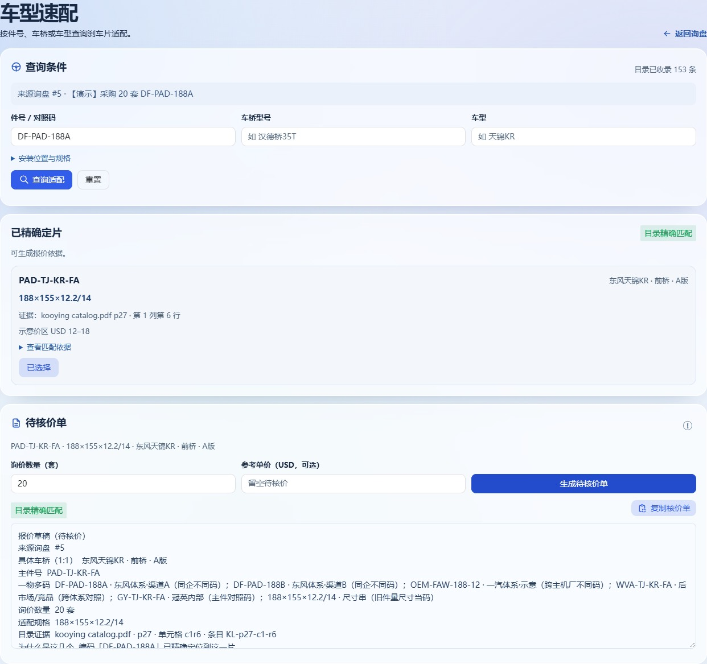
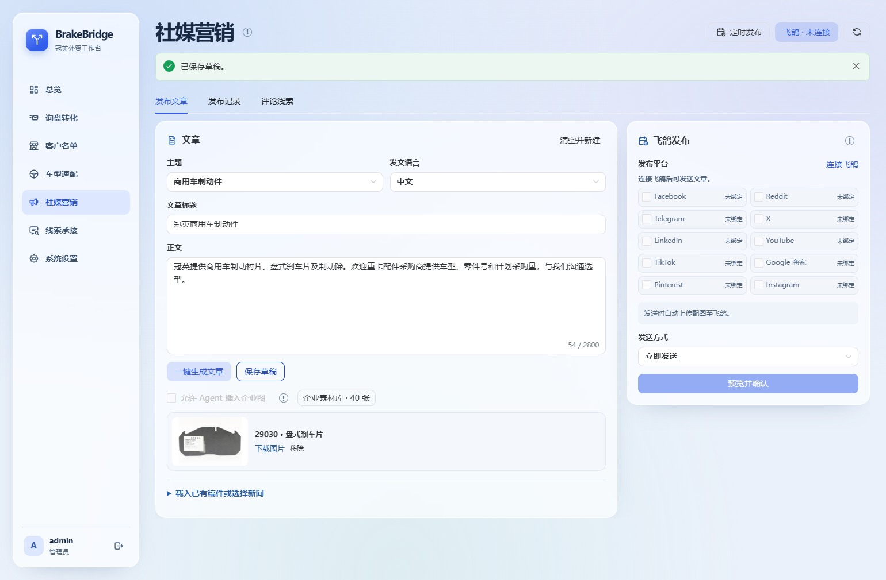
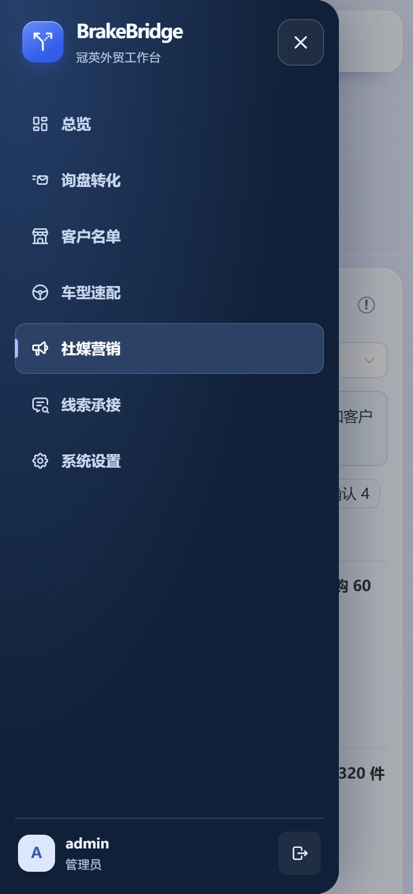
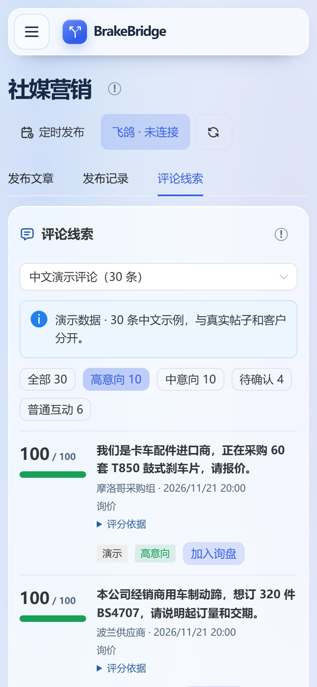

# BrakeBridge · 冠英外贸工作台

## 评委速览

**让冠英外贸团队知道今天先联系谁、客户在问什么、下一步怎么跟进。** 冠英在湖州黑客松 AI+GTM 赛道提出，海关数据和社媒线索里有大量泛汽配企业，销售难以判断对方是否经营卡车制动件、是否有采购或进口能力。团队希望在 12 月 2 日展会前找到在华或计划来华的买家，现场的原话是“客户不在于多，要精准”。

| 企业遇到的问题 | BrakeBridge 怎么解决 |
| --- | --- |
| CRM 里有名单，销售仍要逐家判断 | 导入现有 CRM 或海关表格，按产品匹配、采购或进口证据、中国采购和到展意向排序。每条保留得分依据，缺证据的客户先核实。 |
| 回信和评论分散，展前容易漏跟 | 已导入的询盘、回信和社媒评论可分级跟进。总览直接列出已约见、待确认到展和需优先跟进的买家，并展示负责人和排期。重要客户可继续做有来源的企业背调，找同市场候选和竞品。 |
| 只报车型或旧件号，销售要翻目录才能核价 | 在 153 条目录记录里按件号、车型或车桥查适配。系统给候选、规格和原目录页码，销售确认后生成待核价单。 |
| 每个平台都要单独写稿发帖，采购留言容易被刷掉 | AI 辅助写稿，直接选企业产品图。预览确认一次后，可交给飞鸽定时发布到已绑定平台。评论按意向筛选，明确采购的可加入询盘。 |

**社媒内容也是长期数字资产。** 持续发布有明确型号、适配范围和产品图的原帖，团队可以复用草稿和素材。采购商通过搜索或联网 AI 找供应商时，公开且可收录的帖子有机会被检索、引用，让冠英有机会出现在相关推荐里。

**新增运行成本估算低于 2,000 元/年。** 团队按轻量自部署估算基础运行环境与日常模型调用。方案复用企业已有的转单云和飞鸽账号，省去额外采购一套获客 SaaS 的年订阅。存量账号合同与人工按企业原有口径计。

**这一版可以现场演示**　导入名单 → 看重点买家 → 打开询盘 → 核对车型与件号 → 复制带目录证据的待核价单 → 用社媒发帖并承接下一批线索。

---

## 跟着一条询盘看图操作

以下为当前版本的工作台实拍。客户、询盘和评论使用演示数据，配图来自冠英素材库。

### 1. 先看今天该联系谁

**总览**把重点买家、待跟进询盘、逾期待办和评论放在第一行。点击指标卡、柱状图或业务分布图例，可直接查看对应名单。展会重点名单把已经约见、还需确认到展和需优先联系的人摆在一起。



**客户名单**可导入转单云客户管理格式，按优先级筛选，也可搜索企业名或国家地区。打开一家公司，可以核对它为什么排在前面，并登记负责人、下次跟进时间或准备英文展会邀约草稿。这样新同事也能按同一套标准选客户。



<details>
<summary>查看展会排期和可调整的评分标准</summary>

**展会排期**把目录准备、买家邀约和确认到展排在一条时间线上。横条表示跨日任务，菱形表示单日约见或里程碑。


**系统设置**可以分别调整客户和询盘评分。拖动产品匹配、进口证据等权重，右侧会预览结果。团队也能调整规则分和 AI 分的合成比例。



</details>

### 2. 从一封来信到一张待核价单

演示买家来信要 **20 套 DF-PAD-188A**。打开 **询盘转化**，销售可以对照原文和评分明细，看到“商用车制动片”“请求报价”“20 套”等采购证据，再决定约见、追问或核价。转单云导出和客户邮件都可进入这一流程。


点击 **车型速配**，系统带入来信中的件号。本例找到冠英主件号 **PAD-TJ-KR-FA**，并标明目录第 **27 页**。选择候选、填写 **20 套** 后即可复制核价单，参考单价可留空。只知道车型时，系统会给出待确认候选，请销售核对车桥或旧件规格。



### 3. 发帖获客，再把采购留言接回来

在 **社媒营销** 中选主题和语言，配置模型后可用 AI 起草。销售能直接编辑文字、从企业素材库选图并保存。图中飞鸽未连接，草稿已经保存，配图也保留在稿件里。



连接已授权的飞鸽账号后，勾选已绑定的平台，预览并选择立即发送或定时发送。**定时发布**看待发任务，**发布记录**看各平台回执。审核和定时完成后，发布工作进程会在设定时间执行。

评论进来后，点 **评论线索 → 高意向**，优先看带采购动作、型号或数量的留言。展开 **评分依据** 可以在原文里核对这些信号。点击 **加入询盘**，即可交给销售继续处理。


可访问性、收录和查询相关性会影响公开内容能否出现在联网搜索的 AI 答案里。保留原帖链接并写清产品事实，有利于采购方核实内容。 [ChatGPT 搜索收录说明](https://help.openai.com/en/articles/12627856-publishers-and-developers-faq) · [Google 搜索 AI 功能说明](https://developers.google.com/search/docs/appearance/ai-features)

### 4. 到了展会，手机也能查

点左上角打开导航抽屉。切换页面后抽屉会自动收起。手机上可以从评论筛出明确询价、打开询盘，或者当着客户的面查件号和规格。

| 手机菜单 | 手机查看高意向评论 |
| --- | --- |
|  |  |

## 本地运行

需要 Python 3.12、Node.js 24 和 Git。处理转单云验证码的环境还需安装 Chrome。以下命令在 Windows PowerShell 中执行。

```powershell
git clone https://gitee.com/liuxiansen52/gtm.git
cd gtm
py -3.12 -m venv .venv
.\.venv\Scripts\python.exe -m pip install -r requirements.txt
npm --prefix frontend ci
npm --prefix frontend run build

$env:BRAKEBRIDGE_DB = Join-Path $env:LOCALAPPDATA 'BrakeBridge\workbench-demo.sqlite3'
$env:LEADS_ALLOW_SYNTHETIC = '1'
.\.venv\Scripts\python.exe -m flask --app app seed demo
.\.venv\Scripts\waitress-serve.exe --host=127.0.0.1 --port=8080 app:app
```

打开 [本地工作台](http://127.0.0.1:8080/dashboard)。新演示库默认账号为 `admin`，密码为 `123456`。团队部署可在初始化前设置 `BRAKEBRIDGE_ADMIN_PASSWORD`。升级已有工作台时，在相同的 `gtm` 目录构建并启动，继续使用原来的 `BRAKEBRIDGE_DB`。

`seed demo` 会装入企业获授权的种子资料和演示记录。进入总览后选择 **演示资料**，可练习筛选。要复现图中的核价案例，可直接在车型速配输入 `DF-PAD-188A`，填 20 套生成待核价单。已有库可按需运行 `seed company` 补入企业种子，系统按已有记录去重。

### 接入模型、邮箱和飞鸽

| 要启用的能力 | 配置方式 |
| --- | --- |
| 客户或询盘 AI 评分、写稿与选图 | 在 **系统设置 → 销售 Agent** 选择服务商和模型，填本机密钥，测试连通后保存 |
| 联网取证和新闻来源 | 在 **销售 Agent** 配置联网取证模型，或通过 `SOCIAL_NEWS_FEEDS` 配置 RSS / Atom |
| 飞鸽立即或定时发布 | 在 **社媒营销** 连接已授权账号，按页面提示填写当前验证码。在指向同一数据库的终端启动 `social-worker` |
| 邮件回信和企业微信提醒 | 通过 `LEADS_IMAP_HOST`、`LEADS_IMAP_USER`、`LEADS_IMAP_PASSWORD`、`LEADS_WECOM_WEBHOOK` 和 `LEADS_PUBLIC_URL` 接入，通过 `inquiry-worker` 处理后台同步和推送 |
| 展会资料与会话 | 按需设置 `EVENT_NAME`、`EVENT_DATE`、`EVENT_VENUE`、`EVENT_BOOTH` 和 `BRAKEBRIDGE_SECRET` |

在单独的 PowerShell 终端进入相同的 `gtm` 目录，并将 `BRAKEBRIDGE_DB` 指到 Web 服务使用的 SQLite 文件，再按需运行后台任务。

```powershell
.\.venv\Scripts\python.exe -m flask --app app social-worker
.\.venv\Scripts\python.exe -m flask --app app inquiry-worker
```

`social-worker` 可以加 `--once` 单次检查队列。飞鸽授权需要续期时，可从页面重新连接，也可按需开启会话保活。真实运行库和密钥由各部署环境管理。

技术栈为 Vue 3、TypeScript、Naive UI、ECharts、Flask 和 SQLite。 [团队分工与 PRD](docs/prd/)

```powershell
.\.venv\Scripts\python.exe -m unittest discover -s tests -q
```
